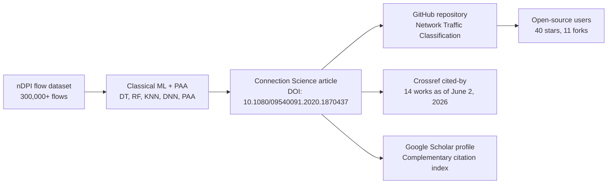

# Repository Impact

This page summarizes public adoption and citation signals for the Network Traffic Classification repository and its associated paper.

Snapshot date: June 2, 2026.

## Public Signals

| Signal | Value | Source |
| --- | ---: | --- |
| GitHub stars | 40 | GitHub repository API and stargazers API |
| GitHub forks | 11 | GitHub repository API and forks API |
| GitHub watchers/subscribers | 2 | GitHub repository API |
| Open GitHub issues | 0 | GitHub repository API |
| Crossref cited-by count | 14 | Crossref work metadata |
| Google Scholar citation profile | Available | Author-maintained Google Scholar profile |
| Paper references in Crossref | 42 | Crossref work metadata |

These are public, reproducible signals. GitHub traffic referrers, viewer geography, clone history, and private demographic data are not exposed through unauthenticated public APIs.

Google Scholar is also useful for showing broader citation visibility, but it does not provide a stable public API for automated repository documentation. Use the author profile below as the primary Scholar-facing link and refresh Scholar counts manually when needed:

https://scholar.google.com/citations?view_op=list_works&hl=en&user=8CqVGlkAAAAJ

## Star Timeline

GitHub exposes `starred_at` timestamps for public stargazers when the stargazers API is requested with the star media type. The repository has received stars across six calendar years.

| Year | Stars |
| --- | ---: |
| 2021 | 7 |
| 2022 | 13 |
| 2023 | 11 |
| 2024 | 5 |
| 2025 | 3 |
| 2026 | 1 |

Notable public star milestones:

| Milestone | User | Date |
| --- | --- | --- |
| First recorded star | `ViewFuture` | March 10, 2021 |
| Most recent recorded star in this snapshot | `SamithaDeshan` | January 18, 2026 |

Highest star-activity months in the public snapshot:

| Month | Stars |
| --- | ---: |
| February 2022 | 3 |
| March 2022 | 3 |
| September 2023 | 2 |
| May 2024 | 2 |
| March 2025 | 2 |

## Fork Timeline

Fork activity shows that researchers and developers have copied the repository for further exploration over multiple years.

| Year | Forks |
| --- | ---: |
| 2020 | 1 |
| 2021 | 1 |
| 2022 | 3 |
| 2023 | 4 |
| 2024 | 1 |
| 2025 | 1 |

Notable public fork milestones:

| Milestone | Repository | Date |
| --- | --- | --- |
| First recorded fork | `skilyxx/Network-Traffic-Classification` | September 20, 2020 |
| Most recent recorded fork in this snapshot | `wangzhiwei1888/Network-Traffic-Classification` | September 23, 2025 |

## Citation Graph

The associated article was published in Connection Science and is the primary scholarly reference for the code and dataset.



## Scholarly Metadata

| Field | Value |
| --- | --- |
| Title | A dynamic network traffic classifier using supervised ML for a Docker-based SDN network |
| Journal | Connection Science |
| Publication date | January 17, 2021 |
| Volume / Issue | 33 / 3 |
| Pages | 693-718 |
| DOI | `10.1080/09540091.2020.1870437` |
| Crossref cited-by count | 14 |
| Google Scholar profile | https://scholar.google.com/citations?view_op=list_works&hl=en&user=8CqVGlkAAAAJ |

## Source Notes

- GitHub repository metadata: `https://api.github.com/repos/pritom007/Network-Traffic-Classification`
- GitHub stargazer timing: `https://api.github.com/repos/pritom007/Network-Traffic-Classification/stargazers`
- GitHub fork timing: `https://api.github.com/repos/pritom007/Network-Traffic-Classification/forks`
- Crossref metadata: `https://api.crossref.org/works/10.1080/09540091.2020.1870437`
- Paper page: `https://doi.org/10.1080/09540091.2020.1870437`
- Google Scholar profile: `https://scholar.google.com/citations?view_op=list_works&hl=en&user=8CqVGlkAAAAJ`

To refresh this page, repeat the public metadata queries, manually check Google Scholar, and update the snapshot date and tables.

You can also run:

```bash
python scripts/collect_repo_impact.py
```
